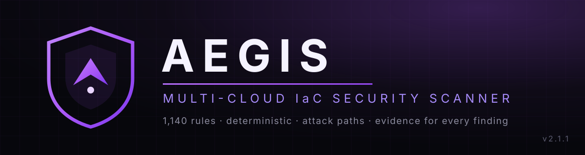

  

## REDA ELMABROUKI — Cloud Security Engineer

I design and build security tooling for cloud infrastructure. My flagship project is **Aegis**, a multi-cloud Infrastructure-as-Code security scanner written in Go engine, detection rules, evaluation science, CI/CD and releases, all in this account.

### 🛡️ Aegis Engine

Aegis scans Terraform, CloudFormation, ARM, Bicep, Kubernetes manifests, Dockerfiles, docker-compose and Pulumi YAML. It builds a resource relationship graph across the whole estate and reports misconfigurations with file-and-line evidence — including full **attack paths** from the internet to your data stores.

| | |
|---|---|
| **Rules** | 1,140 active detection rules, each with positive/negative regression tests |
| **Measured accuracy** | On the frozen R4 ground truth (210 projects, 136 adjudicated concepts): **precision 1.000 · recall 1.000 · F1 1.000** — Checkov 0.331, KICS 0.371, Trivy 0.279 on the same pipeline |
| **Speed** | The 210-project sweep in **2.2 s** (Trivy: 324.9 s) · **1,003,677 findings** on a 1.7M-line fixture in ~2 minutes |
| **Shipping** | Linux, macOS and Windows binaries + a multi-arch Docker image with every release |
| **Engineering** | Deterministic output (byte-identical reruns), quality gates, govulncheck + CodeQL + lint in CI, and a self-scanning security gate that judges only new findings against a checked-in baseline |

→ **[aegis-engine](https://github.com/aeagisenginesec/aegis-engine)** · **[Latest release](https://github.com/aeagisenginesec/aegis-engine/releases/latest)**

Honesty is part of the design: Aegis publishes its blind-set limitations in the repo (R5 recall 0.555, a coverage frontier) next to the wins. A scanner that hides its misses is just marketing.

### Toolbox

Go · Terraform · AWS · Azure · GCP · Kubernetes · Docker · GitHub Actions · DevSecOps / CI-CD security · n8n automation

### Contact

📧 redaxacto@gmail.com
